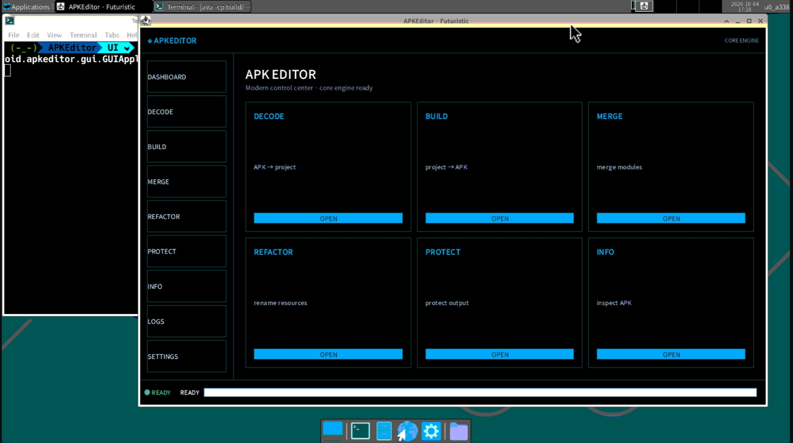
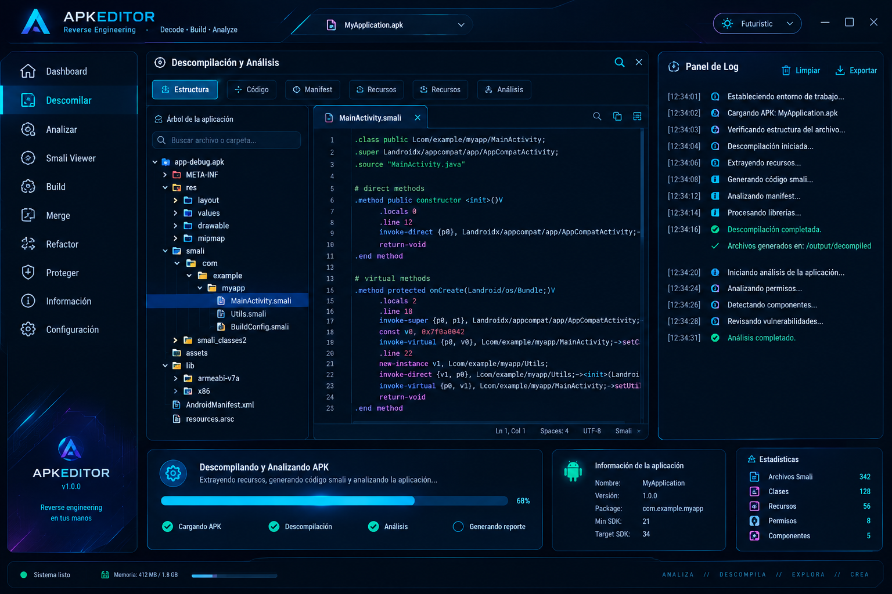

<p align="center">
  <a href="./README.md">Español</a> | <a href="./README.en.md">English</a>
</p>

<p align="center">
  <b>APKEditor Futuristic - Interface</b>
</p>

## Description

APKEditor Futuristic is a modern graphical interface that wraps the original [APKEditor]() engine.

## Final goal



> [!WARNING]
> Work in progress.

## Build

Executable GUI jar:

```bash
sh gradlew guiFatJar --offline
```

The GUI jar is generated at:

```text
build/libs/APKEditor-1.4.9-gui.jar
```

A general fat jar is also available (CLI + GUI):

```bash
sh gradlew fatJar --offline
```

```text
build/libs/APKEditor-1.4.9-all.jar
```

> Use `sh gradlew` if `./gradlew` fails with `permission denied`.

## Launch the graphical interface

### Option 1 - Development classpath

```bash
sh gradlew compileJava --offline

java -cp 'build/classes/java/main:build/resources/main:libs/*' \
  com.reandroid.apkeditor.gui.GUIApplication
```

### Option 2 - GUI jar

```bash
sh gradlew guiFatJar --offline

java -jar build/libs/APKEditor-1.4.9-gui.jar
```

### Termux with VNC

```bash
cd /data/data/com.termux/files/home/proyecto/APKEditor

export DISPLAY=:0
export XAUTHORITY="$HOME/.Xauthority"

java -cp 'build/classes/java/main:build/resources/main:libs/*' \
  com.reandroid.apkeditor.gui.GUIApplication
```

Then open the VNC viewer at `localhost:5900` or the configured port.

## Quick start

1. Open the GUI.
2. Click the APK selector or press `Ctrl+O`.
3. Choose an APK/ZIP file.
4. Browse the tree, open files in the editor, and check the logs.
5. Press `F5` or click **Decompile** to generate the project.
6. Use the **Build**, **Merge**, **Refactor**, and **Protect** views to run the engine operations.
7. Switch between Spanish and English from the top bar or **Settings**.

## Status

The current interface is implemented with Swing + Java2D. It includes live theme switching and Spanish/English language switching. Details about modules, shortcuts, themes, language, operations, and limitations are available in [docs/apkeditor-ui.en.md](docs/apkeditor-ui.en.md).
