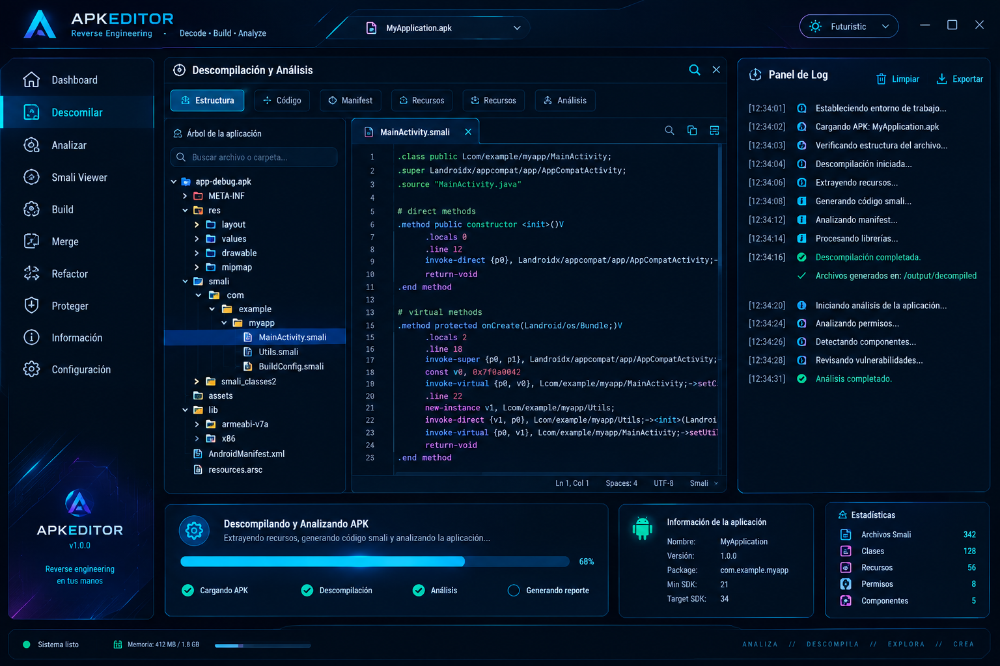

<p align="center">
<<<<<<< HEAD
  <a href="./README.es.md">Español</a> | <a href="https://github.com/VictorH028/APKEditorFuturistic/blob/master/README.md">English</a>
</p>

<p align="center">
=======
>>>>>>> job-work
  <b>APKEditor Futuristic - Interfaz</b>
</p>

<p align="center">
  <a href="./docs/.language/README.es.md">Español</a> | <a href="./README.md">English</a>
</p>


## Descripción

<<<<<<< HEAD
APKEditor Futuristic es una interfaz gráfica moderna que envuelve el motor original de [APKEditor](https://github.com/REAndroid/APKEditor).

## Objetivo final


=======
APKEditor Futuristic es una interfaz nativa JavaFX para el motor original
[APKEditor](https://github.com/REAndroid/APKEditor). La interfaz reutiliza el
motor y sus operaciones; ya no incluye una UI Swing.

## Objetivo final


>>>>>>> job-work

> [!WARNING]
> Trabajo en progreso.

## Compilación

Jar de la interfaz JavaFX (Gradle descarga OpenJFX 21.0.13 en la primera compilación):

```bash
sh gradlew guiFatJar
```

El jar se genera en:

```text
build/libs/APKEditor-1.4.9-gui.jar
```

Incluye la app JavaFX y las clases compartidas/del motor, pero no el runtime de
JavaFX: `guiFatJar` copia los módulos descargados a `build/javafx`. Ejecútalo con:

```bash
java --module-path build/javafx --add-modules javafx.controls \
  -jar build/libs/APKEditor-1.4.9-gui.jar
```

Fat jar solo para el CLI:

```bash
sh gradlew fatJar --offline
```

```text
build/libs/APKEditor-1.4.9-all.jar
```

> Usa `sh gradlew` si `./gradlew` falla con `permission denied`.

## Ejecutar la interfaz gráfica

### Ejecución de desarrollo

```bash
sh gradlew javafxRun
```

### Prueba de humo

```bash
sh gradlew javafxSmoke
```

La primera compilación de JavaFX necesita red para descargar los artefactos de
Maven; después puedes usar `--offline` cuando estén en caché.

## Termux (proot)

Los binarios de OpenJFX están enlazados contra glibc. En Termux, ejecuta la app
dentro del entorno Debian `proot`:

```bash
bash proot-run.sh
bash proot-run.sh --smoke-test
```

`proot-run.sh` usa `~/javaFX/debian-trixie` como rootfs de Debian, ejecuta Gradle
para descargar JavaFX y copiarlo a `build/javafx`, y arranca Xvfb salvo
`START_XVFB=0`. Puedes sobrescribir con `JFX_BASE`, `ROOTFS`, `DISPLAY_NUM` o
`SKIP_BUILD=1`.

Para un display VNC/Termux:X11 existente:

```bash
START_XVFB=0 DISPLAY_NUM=:0 bash proot-run.sh
```

## Inicio rápido

1. Abre la interfaz.
2. Pulsa el selector de APK o `Ctrl+O`.
3. Elige un APK/ZIP.
4. Explora el árbol, abre archivos en el editor y revisa el log.
5. Pulsa `F5` o **Descompilar** para generar el proyecto.
6. Usa **Construir**, **Fusionar**, **Refactorizar** y **Proteger** para ejecutar las operaciones del motor.
7. Cambia entre español e inglés desde la barra superior o **Configuración**.

## Estado

La única interfaz gráfica es la UI nativa JavaFX. Incluye cambio de tema en
caliente, idioma español/inglés, iconos SVG, editor con números de línea, log en
vivo, progreso y el mismo catálogo de operaciones del motor. El detalle de
rutas, temas, atajos y limitaciones está en
[dev-ui](./docs/.language/dev-ui.es.md).
